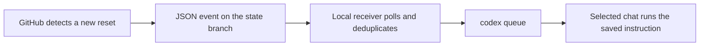

# Trigger local Codex from GitHub events

A reset event detected on GitHub can submit a saved local instruction to a selected Codex chat:



GitHub stores events, and the local receiver uses your existing Codex login. Keep the computer online and Codex available. GitHub email monitoring continues while the computer is off; previously initialized local receivers can process new events when restarted. For independent tasks running entirely in the cloud, the [Codex GitHub Action](https://learn.chatgpt.com/docs/github-action) can be configured separately with an API key. It does not automatically continue a chat on your local computer.

## Privacy and execution

- Chat IDs, saved instructions, and the Codex executable path stay in `data/codex-bridge/config.json`, which is excluded from source control.
- Codex login credentials stay local. You do not need to upload login caches or expose an App Server publicly.
- The receiver reads JSON data from the state branch without checking out or running downloaded source code.
- Public post text never becomes the instruction. Only the instruction saved in local configuration is submitted.
- The first successful read establishes a baseline and ignores existing events. Later reads process new events only.
- The receiver records an attempt before submitting it. Uncertain results require manual review and are not retried automatically, preventing repeated task launches after an ambiguous failure.
- Submitted instructions use the target chat's existing model, permissions, and available quota. A public announcement does not verify that your account has received quota.

The configured repository is a trusted event publisher: anyone with permission to write its state branch can publish an event that triggers the saved instruction. Public read-only visitors cannot publish events to your repository.

## Local setup

Copy `codex-bridge.example.json` to `data/codex-bridge/config.json`. Set the public repository HTTPS URL, target chat UUID, saved instruction, and absolute path to the local Codex executable. On Windows, `(Get-Command codex).Source` prints the executable path. Use forward slashes (`/`) for JSON paths. Never upload the completed configuration file.

First establish the historical baseline, then start listening:

```powershell
python codex_bridge.py --once
python codex_bridge.py --watch
```

Ordinary listening accepts only `reset_completed`. Each event is attempted at most once. Polling does not call a model; only new accepted events submit instructions. Runtime status and progress are stored locally in `data/codex-bridge/`.

## Test the full GitHub delivery path

1. Save a test instruction locally, such as: `Reply only with "GitHub automation test successful". Do not use tools or trigger another test.`
2. Start a bounded receiver:

   ```powershell
   python codex_bridge.py --watch --allow-test --stop-after-one --max-wait-seconds 600
   ```

3. Wait for the receiver to complete its first baseline. Open **Actions > Codex message signal test > Run workflow** on GitHub.
4. GitHub writes an `automation_test_<github_run_id>` event to the state branch. It contains no chat ID, email address, private instruction, or login credentials, and it does not send a reset email.
5. When the local receiver finds the new test event, it submits the saved instruction to the selected chat and stops listening.

If the target chat is busy, the instruction is queued for a later turn. Successful submission and successful task completion are separate outcomes: check the chat's response or execution result. Confirm that `queued_count` increased and `last_event_id` matches the GitHub run. A clean wait deadline without a submission records `exit_reason: "timeout"` and exits with code `2`; this is not a successful test. Source or queue errors exit with code `1`.

After testing, omit `--allow-test`, replace the test instruction with the intended task, and start ordinary listening. Test events do not represent real resets and do not change the reset detector's baseline or email delivery progress.

Official interface reference: [Codex message queue](https://learn.chatgpt.com/docs/cli/reference#codex-queue).
